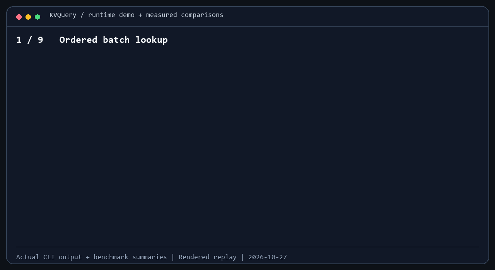

# KVQuery: A Compact C++20 Engine for Batched Key-Value Lookups

KVQuery is an **in-process C++20 query engine for read-heavy, immutable key-value snapshots**. It maps `uint64_t` keys to variable-length byte values and returns views in input order, with explicit snapshot ownership to preserve result lifetime.

The engine combines a compact neighbor-hash index, optional small-value inlining, prefetching, AMAC and SIMD batch probing. Applications include materialized features, document metadata, entity attributes and reference-data snapshots.

[](#build-and-quick-start)
[](docs/ARCHITECTURE.md)
[](docs/API.md)
[](docs/BENCHMARKS.md)
[](#performance-evaluation)
[](#robin-map-comparison)
[](LICENSE)
[](README.zh-CN.md)

## Demonstration



The recorded demonstration covers hits, misses, empty values, duplicate keys, a product-catalog lookup and snapshot reload in a separate process. It also replays measured batch-query comparisons and concurrent reads. [Chapter guide, recording data and reproduction](docs/demo/README.md).

## Performance evaluation

Both comparison suites were measured on **Intel Core Ultra 9 285K, approximately 64 GB RAM, Windows 11/Cygwin and GCC 14.4.0**, using `-O3 -DNDEBUG -msse4.1 -mtune=native`. Single-thread runs are pinned to logical CPU 10, identified as a performance core. Throughput is in **million keys per second (Mkeys/s)**; AMAC, Prefetch and SIMD use window 32.

### std::unordered_map comparison

Each workload uses three independent processes and three rounds per process, with 1,048,576 query keys per round. Each process measures the map and all four engine strategies on identical input records and query traces. Values are process medians.

| Workload | std::unordered_map | Scalar | Prefetch | AMAC | SIMD |
|---|---:|---:|---:|---:|---:|
| 10K records · 32-byte values · batch 256 | 76.18 | 100.70 | 94.34 | 102.94 | 104.18 |
| 1M records · 32-byte values · batch 1,024 | 18.51 | 36.24 | 49.84 | 57.79 | 56.86 |
| 1M records · 32-byte values · batch 256 · 30% hits | 17.20 | 44.44 | 58.08 | 64.26 | 69.78 |
| 250K records · 256-byte values · batch 256 | 21.52 | 41.76 | 47.31 | 51.13 | 50.83 |
| 1M records · 6-byte values · batch 256 | 19.85 | 63.16 | 82.36 | 93.41 | 96.31 |

The target hit rate is 90% except for the miss-heavy case. [Full results, batch latency and exact commands](docs/demo/README.md#matched-comparison-protocol) · [Recorded comparison data](docs/demo/recording.json).

### robin-map comparison


This separate suite uses three independent processes per workload. Timed intervals target 30 seconds per method for larger workloads and 10 seconds for cache-resident and single-key diagnostics. Values are process medians; the chart retains min–max ranges and slow intervals.

| Workload | robin-map | KVQuery AMAC/32 | KVQuery SIMD/32 |
|---|---:|---:|---:|
| 10K records · batch 256 | 83.52 | 104.19 | 105.55 |
| 1M records · batch 1 | 3.98 | 3.74 | 3.66 |
| 1M records · batch 1,024 | 33.36 | 55.66 | 56.19 |
| 8M six-byte records · batch 256 | 31.34 | 82.47 | 82.02 |

KVQuery has higher median throughput for these batched workloads; robin-map has the higher single-key median. Both suites include ordered result allocation, lookup, value-view consumption and destruction. Full result validation runs outside timing. The measurements cover read-only, in-process queries and exclude network and request-queue latency.

[Comparison protocol and all five methods](bench/results/robin-map-2026-10-27/README.md) · [Complete original data archive](https://github.com/Zhang-Xin-Duke/kv-query-engine/releases/tag/benchmark-robin-map-2026-10-27)

Additional measurements: [desktop concurrency and inlining](bench/results/desktop-2026-10-27-rerun/README.md) · [historical Duke benchmarks](docs/HISTORICAL_BENCHMARKS.md). The benchmark design follows the NeighborHash paper and reproduction artifact [[1]](#reference-1), [[2]](#reference-2).

## Architecture


The builder creates a fixed-size index and a value region, then publishes an immutable snapshot. A query selects an execution strategy and returns input-ordered optional views. Each result batch retains its snapshot; applications refresh data by selecting a newly built or loaded snapshot for subsequent queries.

## Design choices

### 1. Resolve collisions during construction


*Move B, repair A’s relative link, then place C at its home. All work happens during construction.*

When two keys map to the same bucket, the builder searches nearby slots in both directions. If a new key's home bucket is occupied by a node belonging to another collision chain, the builder moves that node, repairs the chain, and places the new key at home. Finding space, moving records, and repairing links happen before publication; lookups then compare keys and follow relative links.

This favors a simple read path over cheap insertion. Relative links constrain placement, so bounded rebuild attempts expand the table and change its hash seed when a neighborhood is exhausted.

### 2. Keep index nodes compact and values contiguous


*The same six-byte value can live outside the node or in its existing payload bits. Larger values remain external.*

A 16-byte index node stores a 64-bit key and a packed data word with a 10-bit signed relative link. Values of **0–6 bytes live inside that same node**, using a 48-bit payload, three length bits and a three-bit tag. A successful probe can consume a small value without fetching a separate value region. Larger values use a 36-bit offset and length encoding into contiguous storage; following a collision chain does not read unrelated external values.

The builder calculates the value storage budget and reserves the buffer before copying records. This keeps node size fixed and avoids repeatedly growing the value region during construction.

Inlining avoids a separate value-region access for small values while adding a representation check during view construction. `BuildOptions::inline_small_values = false` selects the external-only layout. Both layouts retain all 64 key bits and share the version-1 persistence format; [encoding details](docs/ARCHITECTURE.md) document the size limits and length extensions.

### 3. Share immutable snapshots across readers


*The application selects the snapshot for new calls. Existing results keep their original bytes alive.*

The index and values remain unchanged after construction. Every query owns its scheduling state and result positions, so readers do not coordinate index mutations. Each batch reads one snapshot throughout execution.

Applications refresh data by building or loading another snapshot and choosing when new requests use it. Existing results retain their original snapshot. This gives reads stable addresses while leaving refresh scheduling and overlapping snapshot memory under application control.

### 4. Compare multiple keys with SIMD and retain unfinished probes


*A four-slot illustration: two sequential SIMD comparisons, immediate refill, and original result positions.*

SIMD batch probing gathers two candidate keys and compares them with a 128-bit vector instruction. Unfinished queries retain their input and collision-chain positions in a residual-state window. Completed positions immediately accept new queries; the remaining probes drain with the same scheduling rules. Original input positions preserve output order and duplicates even when probes finish at different times.

ARM64 uses NEON. x86 uses SSE2 by default, comparing both 32-bit halves of each 64-bit key, or native 64-bit equality when SSE4.1 is enabled by compiler flags. Other targets use a portable fallback. Odd or draining single lanes use direct comparisons. Hashing, noncontiguous node loads, chain transitions and value-view construction remain scalar. `kvquery::simd_backend()` reports the compiled backend.

| Strategy | Execution | Window |
|---|---|---|
| Scalar | Complete one lookup before starting the next | Validated, otherwise unused |
| Prefetch | Prefetch future home buckets ahead of scalar lookup | Input lookahead distance |
| AMAC | Advance independent lookup states one node at a time and refill completed states | Active state count |
| SIMD | Compare two candidate keys per vector and retain/refill unfinished lookups | Residual state count |

All strategies run on the calling thread. Windows from 1 through 256, including non-powers of two, allow workload-specific tuning. Prefetch, AMAC and SIMD add bookkeeping to create opportunities for overlapping access or comparison. Scalar remains the default; [measured results](docs/SIMD_EVALUATION.md) guide the choice.

### Value views and ownership

Results use `optional<string_view>` in input order. `nullopt` represents a miss; an engaged empty view represents a stored empty value. Returning views avoids copying complete payloads. One shared snapshot owner per result batch keeps the referenced bytes alive; retaining a result also retains that complete snapshot.

### Portable records on disk

Snapshot files contain keys, lengths, and value bytes. Loading validates the file and reconstructs the index. The defined byte format is independent of C++ object layout and hash placement, with parsing and rebuilding performed at startup.

Saving writes an exclusive temporary sibling, syncs the file, and publishes it with a same-filesystem hard link. Existing destinations are preserved. Versioned filenames and snapshot handles support application-managed refreshes.

See [Architecture](docs/ARCHITECTURE.md) for layout, construction cases, query state machines, file format, resource budgets and failure behavior.

## Build and quick start

Requirements: a 64-bit POSIX host, a GCC or Clang compiler with C++20 support, CMake 3.20+, and Python 3 for integration tests.

```sh
cmake -S . -B build/release -DCMAKE_BUILD_TYPE=Release
cmake --build build/release -j
ctest --test-dir build/release --output-on-failure

demo_dir="$(mktemp -d "${TMPDIR:-/tmp}/kvquery-demo.XXXXXX")"
printf '0\t\n7\thello\n9\tworld\n' > "$demo_dir/input.tsv"
build/release/kvquery build "$demo_dir/input.tsv" "$demo_dir/data.kwv"
build/release/kvquery inspect "$demo_dir/data.kwv"
build/release/kvquery query "$demo_dir/data.kwv" --strategy simd --window 32 7 8 0 7
```

```text
7	FOUND	68656c6c6f
8	MISSING
0	FOUND	
7	FOUND	68656c6c6f
```

The first tab separates a decimal key from its text value. Empty lines are skipped, CRLF is normalized, and duplicate keys are rejected. Query values are printed as hex. The library supports binary values.

## C++ integration

```cpp
#include <kvquery/kvquery.hpp>
#include <array>
#include <iostream>
#include <vector>

int main() {
    std::vector<kvquery::Record> records{{7, "hello"}, {0, ""}};
    auto snapshot = kvquery::Snapshot::build(records);
    std::array<uint64_t, 4> keys{7, 8, 0, 7};
    auto result = snapshot->query(keys, {kvquery::Strategy::simd, 32});
    snapshot.reset();
    for (size_t i = 0; i < result.size(); ++i) {
        if (result[i]) std::cout << keys[i] << ": " << *result[i] << '\n';
        else std::cout << keys[i] << ": missing\n";
    }
}
```

Link the CMake target `kvquery`. Keep either the result batch or its source snapshot alive while using value views. [API reference](docs/API.md) covers options, budgets, persistence, and errors.

## Validation

Eleven portable CTest groups cover edge values, forced collisions and relocation, randomized differential lookup, result ownership, concurrent access, persistence failures, golden file bytes, SIMD lane/tail handling, inline payloads and cross-layout loading, CLI integration, and benchmark output validation. Linux and Cygwin add a twelfth group for the concurrent benchmark. Linux CI builds GCC Release, Clang Debug, Clang ASan/UBSan, and forced-portable Release configurations.

```sh
cmake -S . -B build/asan -DKVQUERY_SANITIZERS=ON -DCMAKE_BUILD_TYPE=Debug
cmake --build build/asan -j
ctest --test-dir build/asan --output-on-failure
```

ThreadSanitizer is available in a separate build through `-DKVQUERY_TSAN=ON`. See [Validation](docs/VALIDATION.md).

## Source and license

[Figure sources and reproduction](docs/figures/README.md) document which original illustrations informed the redrawn diagrams and which server records drive the charts.

The engine adapts an existing neighbor-hash index and AMAC implementation. [PROVENANCE](docs/PROVENANCE.md) records the source and project changes.

Original project contributions use the **PolyForm Noncommercial License 1.0.0**. Commercial use is not licensed. See [LICENSE](LICENSE) and [NOTICE](NOTICE).

## References

<a id="reference-1"></a>
[1] Q. Zhang, Z. Teng, D. Wu, and J. Wang, “An Enhanced Batch Query Architecture in Real-time Recommendation,” in *Proceedings of the 33rd ACM International Conference on Information and Knowledge Management (CIKM ’24)*, 2024, pp. 5078–5085, doi: [10.1145/3627673.3680034](https://doi.org/10.1145/3627673.3680034).

<a id="reference-2"></a>
[2] slow-steppers, “NeighborHash,” GitHub repository, [Online]. Available: [github.com/slow-steppers/NeighborHash](https://github.com/slow-steppers/NeighborHash). Accessed: Oct. 24, 2026.
