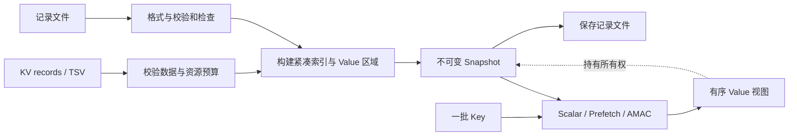

# High-Performance KV Query Engine for Read-Heavy Workloads

**面向读密集型负载的高性能 KV 查询引擎**

[English](README.en.md) · [设计与实现](docs/ARCHITECTURE.md) · [API](docs/API.md) · [性能评测](docs/BENCHMARKS.md) · [非商业许可](LICENSE)

## 为什么做这个项目

一次 AI 请求，往往从一批 ID 开始。

在 RAG 中，向量检索找到相关片段后，还需要根据文档 ID 取回正文；特征服务需要把用户、商品或设备 ID 转成模型所需的属性；Embedding 查询则把一组离散 ID 映射成向量。模型真正开始计算之前，系统已经完成了一轮数据查找与组织。[RAG 文档读取](https://reference.langchain.com/python/langchain-classic/retrievers/multi_vector/MultiVectorRetriever)、[在线特征读取](https://docs.feast.dev/getting-started/components/online-store)和[Embedding 查表](https://docs.pytorch.org/tutorials/intermediate/torchrec_intro_tutorial.html)都体现了这类访问模式。

例如，一次检索得到了 64 个文档 ID。接下来的任务是把这 64 份正文或属性找出来，按原来的顺序交给下游。数据即使已经在内存中，查询仍要定位索引桶、处理哈希冲突，再访问对应的数据。逐条完成这些操作时，前一个节点决定下一个节点的位置，内存访问之间会形成依赖。批量请求也提供了另一个机会：多个 Key 的查询相互独立，可以提前预取，或交错推进它们的查找状态。

这个项目围绕这条读取路径构建：**紧凑地组织索引，提供多种批量执行方式，并把数据加载、查询、结果生命周期和验证串成一个可独立使用的 C++ 组件。**

适合承载的数据包括特征快照、文档与元数据、实体属性、商品目录、规则和参考数据。调用方用 `uint64_t` 标识记录，Value 作为不透明字节保存；文本、序列化记录和向量都可以由应用层编码后存入。

## 功能概览

- **紧凑索引**：16 字节节点，内联编码 Value 位置、长度和冲突链相对偏移。
- **批量执行**：逐条查询、前瞻预取和 AMAC，运行时选择执行策略与窗口。
- **明确的结果语义**：保持输入顺序，区分缺失值与空值，保留重复查询的位置。
- **不可变快照**：构建完成后并发读取，每批结果持有其对应快照。
- **文件持久化**：带版本、长度和校验和的字节格式，加载时校验并重建索引。
- **完整工具链**：CMake 库、CLI、差分测试、并发测试、Sanitizer 配置和服务器基准工具。

## 架构



`Snapshot` 拥有索引和 Value 字节；一次 `query()` 使用该快照回答整批 Key。执行状态属于调用本身，多个线程可以共享同一份已构建数据。`BatchResult` 保存结果位置和快照所有权，调用方使用结果时无需再复制完整 Value。

## 设计与实现

### 让读取面对一份稳定的数据

目标负载以读取为主，因此数据先在构建阶段整理成不可变快照。查询时，索引节点和 Value 的地址保持稳定，执行器只需要维护自己的查找状态。这样可以把并发读取与数据构建分开，也使整批查询自然使用同一份数据。

更新通过构建或加载另一份快照完成。调用方决定什么时候让新请求使用新快照，旧结果继续持有旧数据。这种方式把工作集中到构建阶段，并要求应用安排快照更新时机和新旧数据共存的内存预算。

### 用 16 字节节点表达一次查找

索引采用连续节点数组。每个节点由一个 64 位 Key 和一个 64 位打包字段构成：

| 字段 | 大小 | 含义 |
|---|---:|---|
| Key | 64 bit | 完整的无符号整数标识 |
| Value offset | 36 bit | Value 在连续字节区域中的位置 |
| Value length | 18 bit | Value 长度，含大值扩展标记 |
| Chain link | 10 bit | 下一个冲突节点的相对位置 |

Value 与索引分开存放，使节点大小保持固定，查询先处理紧凑索引，命中后再访问数据。较大的 Value 在数据前保存 32 位长度。Value 区域的第一个字节保留，用于让空节点、Key 为零和空 Value 都有明确表示。

短相对偏移压缩了链指针，也约束了节点之间的距离。因此构建阶段会同时检查新节点与链上相邻端点的可达性；邻域耗尽时，在预算内扩大表容量并更换哈希种子重建。构建复杂度由此增加，换来的是简单、固定大小的读取节点。

### 把冲突节点放在附近，并维护主桶

插入时先定位 Key 的主桶。主桶为空就直接放入；属于同一条链时，从附近两侧寻找空位，将新节点接入链中。

如果主桶被另一个 Key 的冲突节点占用，构建器先找到该节点的前驱，将它迁移到可达空位，修复链，再放入新的主节点。这个过程把更多处理留在构建阶段，让查询沿已有相对链继续查找。详细步骤与实例见[索引构建](docs/ARCHITECTURE.md#3-索引构建)。

### 根据负载组织批量访问

| 策略 | 执行方式 | 窗口含义 |
|---|---|---|
| Scalar | 完整查完一个 Key，再处理下一个 | 校验后不参与执行 |
| Prefetch | 提前预取后续 Key 的主桶，再逐条查询 | 向前预取的 Key 数 |
| AMAC | 轮流推进多条查询的一个节点，完成后补入新 Key | 同时维护的查询状态数 |

前瞻预取增加了提前发起内存访问的机会，也需要额外计算后续桶位置。AMAC 保留每条查询的当前位置与输入序号，遇到冲突就预取下一节点，然后切换到其他状态；初始填充与尾部收尾也沿用这套交错执行方式。

这两种方式用更多调度工作换取访存重叠的机会。数据较小、查询链较短或批次较小时，直接查找的控制开销更低，因此默认使用 Scalar。执行策略与 1–256 的窗口由调用方选择，基准工具用于比较实际负载。

### 返回视图，同时保留数据所有权

结果使用 `optional<string_view>`：缺失 Key 对应 `nullopt`，空 Value 对应存在但长度为零的视图。每条状态记录输入位置，查询完成后直接回填对应槽位。

返回视图避免按查询复制完整 Value，而 `BatchResult` 中的共享快照句柄保证这些视图指向有效数据。代价是共享引用计数，以及长时间持有结果会延长整份快照的存活时间。应用可以保留结果批次，也可以复制需要长期使用的少量字段后释放批次。

### 保存记录，在加载时重建索引

快照文件保存 Key、Value 长度和 Value 字节，加载时检查格式、预算和校验和，再构建内存索引。使用明确的字节格式，使文件不依赖 C++ 对象布局、内存地址和当前哈希表的物理排列。启动时需要支付一次解析与索引构建成本。

保存先写独占创建的临时文件并同步文件内容，再通过同文件系统的硬链接发布目标路径。已有文件会保留，版本切换可以通过新文件名和新的快照句柄组织。[文件格式与发布流程](docs/ARCHITECTURE.md#6-持久化与加载)中给出了具体步骤。

## 快速开始

需要 64 位 POSIX 系统、支持 C++20 的 GCC 或 Clang、CMake 3.20+。运行集成测试需要 Python 3。

```sh
cmake -S . -B build/release -DCMAKE_BUILD_TYPE=Release
cmake --build build/release -j
ctest --test-dir build/release --output-on-failure

demo_dir="$(mktemp -d "${TMPDIR:-/tmp}/kvquery-demo.XXXXXX")"
printf '0\t\n7\thello\n9\tworld\n' > "$demo_dir/input.tsv"
build/release/kvquery build "$demo_dir/input.tsv" "$demo_dir/data.kwv"
build/release/kvquery inspect "$demo_dir/data.kwv"
build/release/kvquery query "$demo_dir/data.kwv" --strategy amac --window 32 7 8 0 7
```

输出按输入顺序排列，Value 使用十六进制显示：

```text
7	FOUND	68656c6c6f
8	MISSING
0	FOUND	
7	FOUND	68656c6c6f
```

TSV 的第一个制表符分隔 Key 与文本 Value。空行跳过，重复 Key 报错。每次演示使用一个新目录，与快照文件不覆盖的保存语义保持一致。

## C++ 接口

```cpp
#include <kvquery/kvquery.hpp>
#include <array>
#include <iostream>
#include <vector>

int main() {
    std::vector<kvquery::Record> records{{7, "hello"}, {0, ""}};
    auto snapshot = kvquery::Snapshot::build(records);
    std::array<uint64_t, 4> keys{7, 8, 0, 7};
    auto result = snapshot->query(keys, {kvquery::Strategy::amac, 32});
    snapshot.reset();
    for (size_t i = 0; i < result.size(); ++i) {
        if (result[i]) std::cout << keys[i] << ": " << *result[i] << '\n';
        else std::cout << keys[i] << ": missing\n";
    }
}
```

通过 CMake 目标 `kvquery` 链接库。完整参数、资源预算、异常和生命周期示例见 [API 参考](docs/API.md)。

## 性能评测

评测围绕数据规模、批大小、命中率、访问分布和 Value 长度展开。基准比较普通哈希表、紧凑索引 Scalar、前瞻预取与 AMAC，输出吞吐和整批请求的 P50/P95/P99。

原设计文档对应的 [CIKM 2024 论文](https://arxiv.org/pdf/2409.00400)与[公开复现仓库](https://github.com/slow-steppers/NeighborHash)提供了服务器实验。下面摘录其 Table 3：Linux 服务器、Intel Xeon Gold 5218、16 GB 数据集、90% 命中率、负载因子 0.8。

**参考实现的服务器消融实验**

| 实现 | 吞吐量（MOPS） | 平均探测缓存行数 |
|---|---:|---:|
| CoalescedHashing | 19 | 1.72 |
| PerfectCellarHash | 23 | 1.48 |
| NeighborProbing | 30 | 1.34 |
| NeighborHash | 39 | 1.14 |

这组实验解释了节点迁移、邻近探测与内联链表示的设计动机。本项目提供独立基准工具，用统一查询语义评估当前引擎。服务器配置、测量范围、参考实验和复现命令集中在[性能文档](docs/BENCHMARKS.md)。

```sh
build/release/kvquery_bench --records 1000000 --batch 256 --queries 262144 --rounds 3
python3 bench/run_suite.py --output bench/results/server-suite.json
python3 bench/summarize.py --input bench/results/server-suite.json --output bench/results/server-report.md
```

## 测试与验证

测试覆盖边界值、确定性冲突与节点迁移、随机差分、结果生命周期、并发读取、保存竞争、损坏文件、固定字节格式与 CLI。Linux CI 运行 GCC Release、Clang Debug 和 Clang ASan/UBSan 三组配置。

```sh
cmake -S . -B build/asan -DKVQUERY_SANITIZERS=ON -DCMAKE_BUILD_TYPE=Debug
cmake --build build/asan -j
ctest --test-dir build/asan --output-on-failure
```

工程目录和各模块职责见[设计文档](docs/ARCHITECTURE.md#8-代码组织与验证)。

## 资料与许可

索引设计与 AMAC 基于既有实现整理与适配，具体来源和改动见 [PROVENANCE](docs/PROVENANCE.md)。应用背景参考 Feast、LangChain 和 PyTorch 的官方文档；基准设计参考 NeighborHash 论文及其公开复现工程。

项目原创部分采用 **PolyForm Noncommercial License 1.0.0**，禁止商业使用。许可全文见 [LICENSE](LICENSE)，版权和沿用部分说明见 [NOTICE](NOTICE)。
