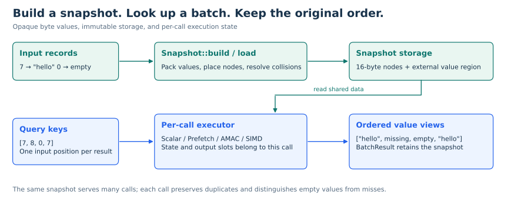
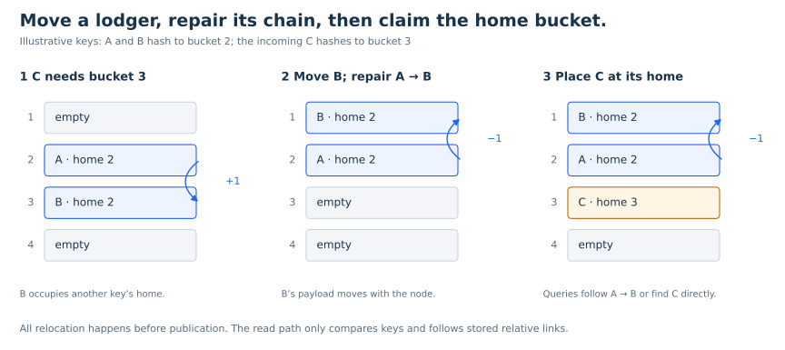
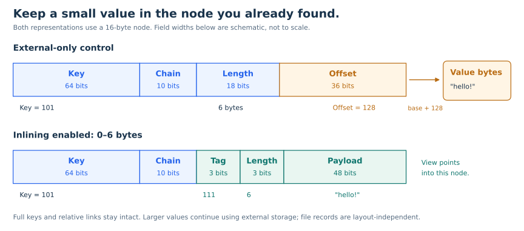
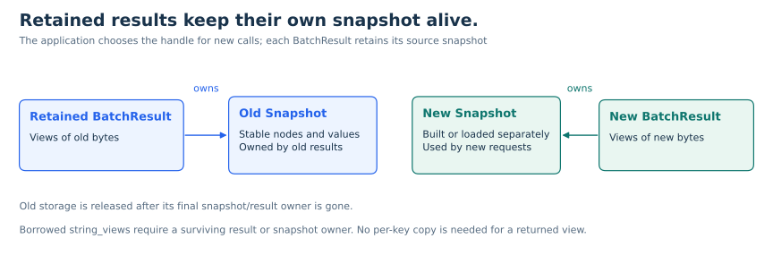
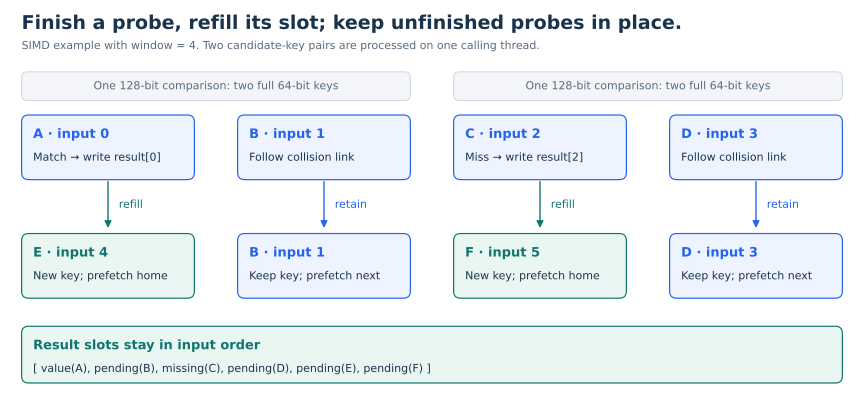

# KVQuery: A Compact C++20 Engine for Batched Key-Value Lookups

[Quick Start](#build-and-quick-start) · [Architecture](docs/ARCHITECTURE.md) · [API Reference](docs/API.md) · [Benchmark Guide](docs/BENCHMARKS.md) · [Performance Results](bench/results/desktop-2026-10-27-rerun/README.md) · [License](LICENSE) · [简体中文](README.zh-CN.md)

## Introduction

An AI request often begins with a batch of IDs.



*A concrete batch includes a hit, a miss, an empty value and a repeated key.*

A retrieval pipeline identifies relevant chunks and then fetches their documents. A feature service turns entity IDs into model inputs. An embedding lookup maps discrete IDs to vectors. These reads prepare the data that downstream computation consumes; examples appear in the official documentation for [LangChain retrieval](https://reference.langchain.com/python/langchain-classic/retrievers/multi_vector/MultiVectorRetriever), [Feast online features](https://docs.feast.dev/getting-started/components/online-store), and [PyTorch embedding tables](https://docs.pytorch.org/tutorials/intermediate/torchrec_intro_tutorial.html).

Consider a search returning 64 document IDs. Before constructing the final context, the application must retrieve the corresponding records and preserve their association with those IDs. Even with resident data, each lookup must locate a bucket, follow any collision chain, and access the value. Dependent memory accesses can limit progress, while independent lookups within the batch create opportunities to prefetch and interleave work.

This C++20 engine brings together a compact immutable index, configurable batch execution, snapshot persistence, and explicit result ownership. It is suitable for read-heavy reference data such as document metadata, materialized features, entity attributes, catalogs, and rules. Applications encode records as `uint64_t` keys and opaque value bytes.

## Features

- **16-byte index nodes:** packed value offsets, lengths, and relative collision links.
- **Small-value inlining:** values of 0–6 bytes share the existing node; larger values use contiguous external storage.
- **Four execution strategies:** scalar, lookahead prefetch, AMAC, and SIMD batch probing, selected per call.
- **Ordered results:** duplicate keys retain their positions; missing and empty values are distinct.
- **Immutable snapshots:** concurrent readers share stable index and value storage.
- **Owned result lifetime:** a result batch retains the snapshot behind its value views.
- **Checked persistence:** versioned little-endian records, length checks, resource budgets, and checksums.
- **Independent tooling:** CMake library, CLI, correctness tests, sanitizers, Linux CI, and a benchmark suite.

## Design

### 1. Resolve collisions during construction



*Move B, repair A’s relative link, then place C at its home. All work happens during construction.*

When two keys map to the same bucket, the builder searches nearby slots in both directions. If a new key's home bucket is occupied by a node belonging to another collision chain, the builder moves that node, repairs the chain, and places the new key at home. Finding space, moving records, and repairing links happen before publication; lookups then compare keys and follow relative links.

This favors a simple read path over cheap insertion. Relative links constrain placement, so bounded rebuild attempts expand the table and change its hash seed when a neighborhood is exhausted.

### 2. Keep index nodes compact and values contiguous



*The same six-byte value can live outside the node or in its existing payload bits. Larger values remain external.*

A 16-byte index node stores a 64-bit key and a packed data word with a 10-bit signed relative link. Values of **0–6 bytes live inside that same node**, using a 48-bit payload, three length bits and a three-bit tag. A successful probe can consume a small value without fetching a separate value region. Larger values use a 36-bit offset and length encoding into contiguous storage; following a collision chain does not read unrelated external values.

The builder calculates the value storage budget and reserves the buffer before copying records. This keeps node size fixed and avoids repeatedly growing the value region during construction.

Inlining uses existing node space and preserves all 64 key bits. It adds a layout check to view construction and reserves some length codes: external lengths below 229376 are direct, and larger values use a four-byte length prefix. `BuildOptions::inline_small_values = false` selects the external-only layout for comparison. Both layouts return snapshot-owned views and read/write the same version-1 files.

### 3. Share immutable snapshots across readers



*The application selects the snapshot for new calls. Existing results keep their original bytes alive.*

The index and values remain unchanged after construction. Every query owns its scheduling state and result positions, so readers do not coordinate index mutations. Each batch reads one snapshot throughout execution.

Applications refresh data by building or loading another snapshot and choosing when new requests use it. Existing results retain their original snapshot. This gives reads stable addresses while leaving refresh scheduling and overlapping snapshot memory under application control.

### 4. Compare multiple keys with SIMD and retain unfinished probes



*A four-slot illustration: two sequential SIMD comparisons, immediate refill, and original result positions.*

SIMD batch probing gathers two candidate keys and compares them with a 128-bit vector instruction. Unfinished queries retain their input and collision-chain positions in a residual-state window. Completed positions immediately accept new queries; the remaining probes drain with the same scheduling rules. Original input positions preserve output order and duplicates even when probes finish at different times.

ARM64 uses NEON; x86 uses SSE2, comparing both 32-bit halves of each full 64-bit key. Other targets use a portable fallback. Odd or draining single lanes use direct comparisons. Hashing, noncontiguous node loads, chain transitions and value-view construction remain scalar. `kvquery::simd_backend()` reports the compiled backend.

| Strategy | Execution | Window |
|---|---|---|
| Scalar | Complete one lookup before starting the next | Validated, otherwise unused |
| Prefetch | Prefetch future home buckets ahead of scalar lookup | Input lookahead distance |
| AMAC | Advance independent lookup states one node at a time and refill completed states | Active state count |
| SIMD | Compare two candidate keys per vector and retain/refill unfinished lookups | Residual state count |

All strategies run on the calling thread. Windows from 1 through 256, including non-powers of two, allow workload-specific tuning. Prefetch, AMAC and SIMD add bookkeeping to create opportunities for overlapping access or comparison. Scalar remains the default; [measured results](docs/SIMD_EVALUATION.md) guide the choice.

### Value views and ownership

Results use `optional<string_view>` in input order. `nullopt` represents a miss; an engaged empty view represents a stored empty value. Returning views avoids copying complete payloads. One shared snapshot owner per result batch keeps the referenced bytes alive; retaining a result also retains that complete snapshot.

### Portable records on disk

Snapshot files contain keys, lengths, and value bytes. Loading validates the file and reconstructs the index. The defined byte format is independent of C++ object layout and hash placement, with parsing and rebuilding performed at startup.

Saving writes an exclusive temporary sibling, syncs the file, and publishes it with a same-filesystem hard link. Existing destinations are preserved. Versioned filenames and snapshot handles support application-managed refreshes.

See [Architecture](docs/ARCHITECTURE.md) for layout, construction cases, query state machines, file format, resource budgets and failure behavior.

## Build and quick start

Requirements: a 64-bit POSIX host, a GCC or Clang compiler with C++20 support, CMake 3.20+, and Python 3 for integration tests.

```sh
cmake -S . -B build/release -DCMAKE_BUILD_TYPE=Release
cmake --build build/release -j
ctest --test-dir build/release --output-on-failure

demo_dir="$(mktemp -d "${TMPDIR:-/tmp}/kvquery-demo.XXXXXX")"
printf '0\t\n7\thello\n9\tworld\n' > "$demo_dir/input.tsv"
build/release/kvquery build "$demo_dir/input.tsv" "$demo_dir/data.kwv"
build/release/kvquery inspect "$demo_dir/data.kwv"
build/release/kvquery query "$demo_dir/data.kwv" --strategy simd --window 32 7 8 0 7
```

```text
7	FOUND	68656c6c6f
8	MISSING
0	FOUND	
7	FOUND	68656c6c6f
```

The first tab separates a decimal key from its text value. Empty lines are skipped, CRLF is normalized, and duplicate keys are rejected. Query values are printed as hex. The library supports binary values.

## C++ integration

```cpp
#include <kvquery/kvquery.hpp>
#include <array>
#include <iostream>
#include <vector>

int main() {
    std::vector<kvquery::Record> records{{7, "hello"}, {0, ""}};
    auto snapshot = kvquery::Snapshot::build(records);
    std::array<uint64_t, 4> keys{7, 8, 0, 7};
    auto result = snapshot->query(keys, {kvquery::Strategy::simd, 32});
    snapshot.reset();
    for (size_t i = 0; i < result.size(); ++i) {
        if (result[i]) std::cout << keys[i] << ": " << *result[i] << '\n';
        else std::cout << keys[i] << ": missing\n";
    }
}
```

Link the CMake target `kvquery`. Keep either the result batch or its source snapshot alive while using value views. [API reference](docs/API.md) covers options, budgets, persistence, and errors.

## Performance evaluation

The benchmark design follows the NeighborHash paper and its public reproduction artifact [[1]](#reference-1), [[2]](#reference-2).

All results below were measured on the **Duke Linux course server** on October 24, 2026: Intel Xeon E5-2440 v2 (8 cores / 16 logical CPUs), approximately 16 GB RAM, Ubuntu 22.04.5, GCC 11.4.0, and `-std=c++20 -O3 -DNDEBUG`. The single-threaded benchmark is pinned to CPU 0; the native SIMD backend is SSE2. No `-march=native` flags are used.

Each workload runs in **three independent processes, three rounds per process**. The table reports median throughput in **million keys per second**. Prefetch, AMAC and SIMD use a fixed window of 32 here; all tested windows and batch P50/P95/P99 remain in the raw results.


*Server process medians with min/max whiskers. All throughput bars start at zero; the complete table also includes Prefetch.*

<details>
<summary>Full standard-workload throughput table</summary>

| Workload | unordered_map | Scalar | Prefetch/32 | AMAC/32 | SIMD/32 |
|---|---:|---:|---:|---:|---:|
| small-uniform | 17.78 | 32.97 | 31.40 | 33.50 | 32.85 |
| large-single | 1.59 | 2.77 | 2.96 | 2.96 | 2.89 |
| large-batch32 | 6.13 | 14.26 | 15.52 | 15.68 | 15.75 |
| large-batch256 | 6.23 | 15.33 | 18.96 | 21.49 | 21.15 |
| large-batch1024 | 5.86 | 15.30 | 19.30 | 21.98 | 22.13 |
| large-low-hit | 5.25 | 19.62 | 24.64 | 28.22 | 28.03 |
| large-hot | 9.25 | 31.77 | 36.98 | 39.19 | 38.54 |
| wide-values | 7.24 | 17.18 | 19.25 | 20.76 | 20.64 |

</details>

For `large-batch1024` (one million records, 32-byte values, batches of 1,024 keys, 90% target hit rate), SIMD/32 reaches **22.13 Mkeys/s**: **1.45× Scalar** and **3.78× `std::unordered_map`**. AMAC/32 reaches 21.98 Mkeys/s in the same workload. These 32/256-byte workloads use external values even with inlining enabled; they measure the final query implementation. Batch size, working set and hit distribution guide executor selection.

All methods process identical inputs and return input-ordered value views. Full result equality is checked outside the timed sections. Timing includes result allocation, lookup, ownership, value length/end-byte consumption, and result destruction. These are in-process batch-lookup measurements.

- [Raw server results and source/binary hashes](bench/results/duke-x86-inline-2026-10-24.json)
- [Full throughput and batch P99 report](bench/results/duke-x86-inline-2026-10-24.md)
- [Recorded server environment](bench/results/duke-x86-inline-2026-10-24.environment.txt)
- [Workloads and measurement protocol](docs/BENCHMARKS.md)
- [SIMD implementation and analysis](docs/SIMD_EVALUATION.md)

Reproduce the complete build, correctness checks and 24-process suite on a Linux host with GCC, Python 3, `ar`, and `taskset`:

```sh
bash bench/run_linux.sh bench/results/linux-suite 0
```

A CMake build can also run the suite through `bench/run_suite.py`; its `--build-description` option records the actual compilation setup.

### Small-value inlining: paired comparison

Both layouts run in the same process with identical records and query traces,
rotating and alternating measurement order. The table uses one million records,
batches of 256 keys, a 90% hit target and SIMD/32. Rates are process medians in
Mkeys/s; ratios are medians of matched per-process ratios. Logical storage counts
index nodes plus the external value region, excluding allocator overhead and
other process memory.


*The 1.0 line is equal throughput. Small-value gains and the mixed-value cost are both shown.*

<details>
<summary>Exact paired ratios and logical-storage table</summary>

| Value distribution | External-only | Inlining enabled | Paired ratio | Logical storage MB, before → after |
|---|---:|---:|---:|---:|
| 1 byte | 29.34 | 31.82 | 1.083× | 21.00 → 20.00 |
| 2 bytes | 27.84 | 32.21 | 1.157× | 22.00 → 20.00 |
| 4 bytes | 25.47 | 31.76 | 1.244× | 24.00 → 20.00 |
| 6 bytes | 24.26 | 31.78 | 1.310× | 26.00 → 20.00 |
| 7 bytes (control) | 24.06 | 23.89 | 0.993× | 27.00 → 27.00 |
| 32 bytes (control) | 21.15 | 20.94 | 0.987× | 52.00 → 52.00 |
| 50% 6-byte + 50% 32-byte | 22.27 | 21.44 | 0.960× | 39.00 → 36.00 |

</details>

For six-byte values, inlining improves throughput by **31.0%** and reduces logical
storage by **23.1%**, keeping every node at 16 bytes. Scalar improves by 23.6% and
AMAC/32 by 28.1% in the same case. The gain depends on value access and working-set
size: the cache-resident six-byte case improves SIMD by 2.2%, and a 30%-hit case by
9.7%. The full report retains every length from zero through six and all controls.

The half-small/half-large case reduces storage by 7.7% but lowers SIMD throughput
by 4.0% (Scalar by 6.9%). Mixed layouts add a representation decision to successful
lookups; this tradeoff should be measured for the application's value distribution.
The external-only build option provides a direct alternative:

```cpp
kvquery::BuildOptions options;
options.inline_small_values = false;
auto snapshot = kvquery::Snapshot::build(records, options);
```

- [Paired raw results, hashes and all windows](bench/results/duke-inline-2026-10-24.json)
- [All 16 cases, process ranges and storage counts](bench/results/duke-inline-2026-10-24.md)
- [Inline layout, lifetime and implementation details](docs/INLINE_EVALUATION.md)

```sh
bash bench/run_linux.sh bench/results/linux-inline 0 inline
```

### Larger working sets

The scaling test holds value size at six bytes, batch size at 256, target hit rate
at 90%, and **1,048,576 queries per round** across all three sizes. It uses the same
server, binary, CPU affinity and paired measurement protocol. Each case runs in
three independent processes with three rounds. Throughput is in Mkeys/s; gains
are matched per-process ratio medians.


*The same server binary measures both layouts. Logical storage counts index and external-value bytes.*

<details>
<summary>Exact scaling results</summary>

| Records | SIMD/32 external | SIMD/32 inline | SIMD gain | AMAC/32 gain | Logical storage MB, before → after |
|---|---:|---:|---:|---:|---:|
| 1,000,000 | 25.07 | 31.94 | +27.4% | +27.0% | 26 → 20 |
| 4,000,000 | 20.08 | 28.78 | +41.8% | +43.3% | 104 → 80 |
| 8,000,000 | 18.17 | 26.57 | +46.0% | +48.2% | 208 → 160 |

</details>

The relative SIMD gain rises from 27.4% at one million records to 46.0% at eight
million; AMAC/32 reaches 48.2%. Inlined logical storage at eight million records is
160 MB versus 208 MB externally. Absolute throughput falls as the dataset grows,
while inlining reduces the loss relative to external-only storage. The index
arrays span roughly 20, 80 and 160 MB on a server with a 20 MiB L3 cache. This
trend is consistent with avoiding external-value accesses becoming more valuable
as the working set expands. These are single-threaded working-set measurements.

- [Scaling raw results and source/binary hashes](bench/results/duke-inline-scale-2026-10-24.json)
- [Scaling process ranges and full strategy results](bench/results/duke-inline-scale-2026-10-24.md)

```sh
bash bench/run_linux.sh bench/results/linux-inline-scale 0 inline-scale
```

## Validation

Eleven CTest groups cover edge values, forced collisions and relocation, randomized differential lookup, result ownership, concurrent access, persistence failures, golden file bytes, SIMD lane/tail handling, inline payloads and cross-layout loading, CLI integration, and benchmark output validation. Linux CI builds GCC Release, Clang Debug, Clang ASan/UBSan, and forced-portable Release configurations.

```sh
cmake -S . -B build/asan -DKVQUERY_SANITIZERS=ON -DCMAKE_BUILD_TYPE=Debug
cmake --build build/asan -j
ctest --test-dir build/asan --output-on-failure
```

ThreadSanitizer is available in a separate build through `-DKVQUERY_TSAN=ON`. See [Validation](docs/VALIDATION.md).

## Source and license

[Figure sources and reproduction](docs/figures/README.md) document which original illustrations informed the redrawn diagrams and which server records drive the charts.

The engine adapts an existing neighbor-hash index and AMAC implementation. [PROVENANCE](docs/PROVENANCE.md) records the source and project changes.

Original project contributions use the **PolyForm Noncommercial License 1.0.0**. Commercial use is not licensed. See [LICENSE](LICENSE) and [NOTICE](NOTICE).

## References

<a id="reference-1"></a>
[1] Q. Zhang, Z. Teng, D. Wu, and J. Wang, “An Enhanced Batch Query Architecture in Real-time Recommendation,” in *Proceedings of the 33rd ACM International Conference on Information and Knowledge Management (CIKM ’24)*, 2024, pp. 5078–5085, doi: [10.1145/3627673.3680034](https://doi.org/10.1145/3627673.3680034).

<a id="reference-2"></a>
[2] slow-steppers, “NeighborHash,” GitHub repository, [Online]. Available: [github.com/slow-steppers/NeighborHash](https://github.com/slow-steppers/NeighborHash). Accessed: Oct. 24, 2026.
