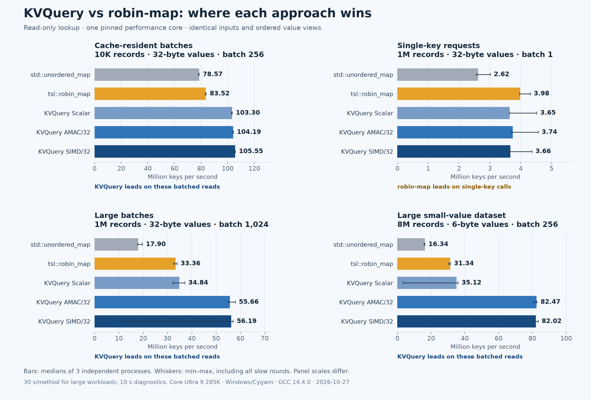

# KVQuery vs Tessil robin-map



[Scalable SVG](comparison.svg) · [Complete original data archive](https://github.com/Zhang-Xin-Duke/kv-query-engine/releases/download/benchmark-robin-map-2026-10-27/offline-comparison-2026-10-27.zip) · [GitHub data release](https://github.com/Zhang-Xin-Duke/kv-query-engine/releases/tag/benchmark-robin-map-2026-10-27)

## What the measurements show

Throughput is million keys/s, medians of three independent processes. This is read-only, in-process batch lookup on one pinned performance core.

| Workload | robin-map | KVQuery AMAC/32 | KVQuery SIMD/32 |
|---|---:|---:|---:|
| 10K records · batch 256 | 83.52 | 104.19 | 105.55 |
| 1M records · batch 1 | 3.98 | 3.74 | 3.66 |
| 1M records · batch 1,024 | 33.36 | 55.66 | 56.19 |
| 8M six-byte records · batch 256 | 31.34 | 82.47 | 82.02 |

The tested KVQuery batched paths lead in these workloads. Robin-map has the higher single-key median. The three-process sample is small; min/max ranges are retained and small differences are not significance claims.

## All measured methods

| Workload | std::unordered_map | robin-map | KV Scalar | KV AMAC/32 | KV SIMD/32 |
|---|---:|---:|---:|---:|---:|
| 10K records · batch 256 | 78.57 | 83.52 | 103.30 | 104.19 | 105.55 |
| 1M records · batch 1 | 2.62 | 3.98 | 3.65 | 3.74 | 3.66 |
| 1M records · batch 1,024 | 17.90 | 33.36 | 34.84 | 55.66 | 56.19 |
| 8M six-byte records · batch 256 | 16.34 | 31.34 | 35.12 | 82.47 | 82.02 |

## Protocol and boundaries

- Host: Intel Core Ultra 9 285K, approximately 64 GB RAM; logical CPU 10, identified as a performance core. Windows 11/Cygwin, GCC 14.4.0, `-O3 -DNDEBUG -msse4.1 -mtune=native`. The retained library uses GNU C++20; the comparison harness uses C++20. Exact flags are in the archive.
- Upstream: [Tessil/robin-map at `91362aab8f2c63ef90bf7c21fb2c3283ded5ae48`](https://github.com/Tessil/robin-map/tree/91362aab8f2c63ef90bf7c21fb2c3283ded5ae48), two commits after v1.4.1. Instantiation: `tsl::robin_map<uint64_t, std::string, Hash>`. Source snapshot and original MIT license are retained.
- Three independent processes per workload, one timed interval per method per process. Heavy-workload intervals target 30 seconds; cache/single-key diagnostic intervals target 10 seconds. Actual total timed wall duration: **1,230.851253 seconds**. Method/workload order rotates or reverses deterministically, as recorded in the harness and logs.
- Each process uses a deterministic cyclic trace of 1,048,576 uniformly selected keys, with a 90% hit target. Containers receive identical records and queries within a process. The same initial 64-bit mixer is used. Maps request a maximum load factor of 0.8; actual bucket counts/load factors differ with growth policy and are recorded.
- Both map adapters allocate input-ordered optional string views and keep the container alive for the whole fixture. Native KVQuery results additionally retain snapshot ownership. Allocation/destruction, lookup, ownership handling and value length/endpoint-byte consumption are timed; payloads are not copied. This measures complete API/storage paths, not isolated hashing or SIMD instructions.
- Full result bytes across the entire trace are verified outside timing. Timed batches are checked against independently generated expected checksums. Faster methods finish more batches, so their final checksum totals need not equal one another. Every retained result passed.
- One call in 64 is sampled for latency. Every raw sampled call and every throughput interval is preserved. All reported percentiles were reproduced from those 11,160,811 samples; interval counts/rates reconcile with completed batches.
- This is a synthetic single-thread read benchmark, not concurrent-service capacity, network QPS, mutation throughput, persistence throughput or an end-to-end SLA. A batch of one uses a direct comparison in the SIMD path.

## Variation and retained long intervals

The 35.279032-second interval in eight-million-record Scalar process 1 and the 42.5442503-second interval in large-batch SIMD process 3 are retained. They lower their complete-process wall-time rates and appear in the min/max whiskers. The cause was not isolated; no OS, scheduler, allocator or clock attribution is claimed. Sampled P99 is not a worst-case-pause guarantee. No completed slow round was removed, restarted or replaced.

## Project scope

| Aspect | KVQuery | Tessil robin-map |
|---|---|---|
| Core use | Immutable uint64-to-byte snapshots | Generic mutable Robin Hood hash-map/set containers |
| Batch lookup | Native Scalar, Prefetch, AMAC and SIMD schedulers | Const `find` adapted into an ordered batch loop here |
| Value lifetime | Result batch retains its snapshot | Benchmark fixture retains the container |
| Storage | 16-byte index nodes; contiguous external bytes; up to six bytes inline | Generic key/value bucket representation |
| Persistence | Checked versioned snapshot file interface | Serialization/deserialization hooks |

Mutation and persistence features are not exercised in this timing. KV logical storage is not process RSS, and bucket counts are not total memory measurements; no cross-container RAM-saving ratio is claimed.

## Data and reproduction

The [GitHub release](https://github.com/Zhang-Xin-Duke/kv-query-engine/releases/tag/benchmark-robin-map-2026-10-27) contains the **byte-identical complete ZIP** of all 218 original files (146,469,506 expanded bytes; 38,654,061 ZIP bytes). The repository includes readable summaries and per-process JSON/logs; every raw latency CSV and every other original artifact is in that ZIP.

- [summary.csv](summary.csv): medians, min/max rates, matched per-process ratios and latency summaries.
- [per-process-summary.csv](per-process-summary.csv): all 60 timed method measurements.
- [throughput-timeseries.csv](throughput-timeseries.csv): every retained monitoring interval.
- [validation.json](validation.json): accounting, percentile and checksum checks.
- [REPORT.txt](REPORT.txt): complete original text report.
- [archive-SHA256SUMS.json](archive-SHA256SUMS.json): file hashes for the **extracted original ZIP contents**, not the separately formatted repository index.
- [source/offline_robin_compare.cpp](source/offline_robin_compare.cpp): measured comparison harness.
- [source/plot_comparison.py](source/plot_comparison.py): chart renderer, taking `--input` and `--output` directories. Matplotlib/NumPy versions are in [publication.json](publication.json).

The archive additionally preserves exact engine/upstream source archives, the exact compiled source bytes, measured executable/library, original licenses/NOTICE, dependency hashes, build flags, all smoke and setup logs, and the unselected SQLite development pilot. SQLite pilot numbers are excluded from all comparison conclusions. Extract the ZIP and run its `REPRODUCE.sh` in the recorded Cygwin toolchain; inspect/edit the fixed CPU-10 pin when moving to another host.

Archive SHA-256:

```text
1136e95f555c927b9cb5b17644da59f65e8d786c6102a4d964b73f2d4a4de462
```

The original archive and measured numeric data are unmodified. Current project title, demo and historical Duke measurements remain in place.
