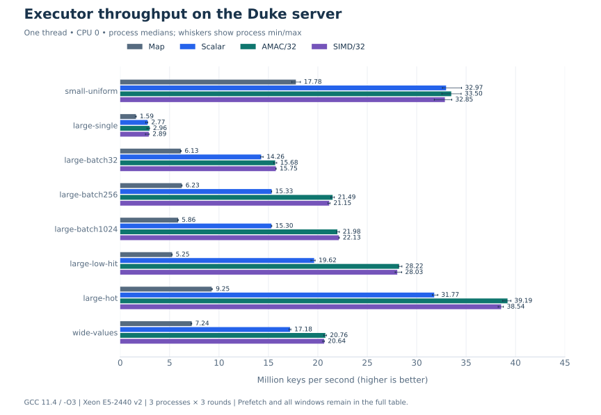
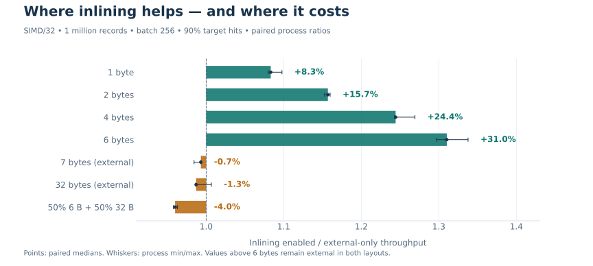
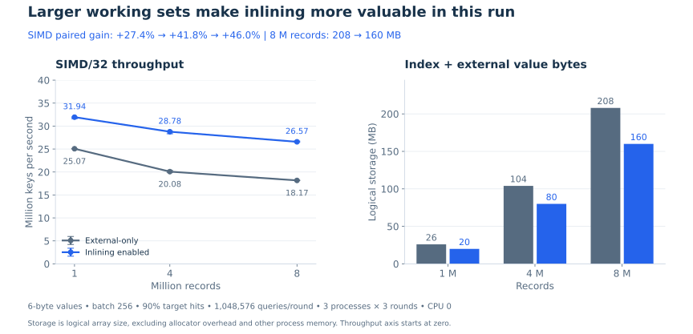

# Duke 服务器历史基准

以下保留 2026 年 10 月 24 日的测试条件、结果和原始数据链接。首页统一展示新台式机上的两套对照。

## 性能评测

基准设计参考 NeighborHash 论文及其公开复现工程 [[1]](https://github.com/Zhang-Xin-Duke/kv-query-engine/blob/41f8981/README.zh-CN.md#reference-1), [[2]](https://github.com/Zhang-Xin-Duke/kv-query-engine/blob/41f8981/README.zh-CN.md#reference-2)。以下结果全部来自 2026-10-24 的 Duke Linux 课程服务器：Xeon E5-2440 v2、8 核 16 线程、约 16 GB 内存、Ubuntu 22.04.5、GCC 11.4.0，使用 `-std=c++20 -O3 -DNDEBUG`，固定 CPU 0，SIMD 后端为 SSE2。

8 类负载各运行 3 个独立进程，每进程 3 轮。表格为进程中位数，单位是每秒百万次 Key 查询；Prefetch、AMAC、SIMD 统一展示窗口 32。




*图中为进程中位数，误差线表示进程最小值与最大值。*

<details>
<summary>展开完整数值表</summary>

| Workload | unordered_map | Scalar | Prefetch/32 | AMAC/32 | SIMD/32 |
|---|---:|---:|---:|---:|---:|
| small-uniform | 17.78 | 32.97 | 31.40 | 33.50 | 32.85 |
| large-single | 1.59 | 2.77 | 2.96 | 2.96 | 2.89 |
| large-batch32 | 6.13 | 14.26 | 15.52 | 15.68 | 15.75 |
| large-batch256 | 6.23 | 15.33 | 18.96 | 21.49 | 21.15 |
| large-batch1024 | 5.86 | 15.30 | 19.30 | 21.98 | 22.13 |
| large-low-hit | 5.25 | 19.62 | 24.64 | 28.22 | 28.03 |
| large-hot | 9.25 | 31.77 | 36.98 | 39.19 | 38.54 |
| wide-values | 7.24 | 17.18 | 19.25 | 20.76 | 20.64 |

</details>

百万条记录、每批 1024 个 Key 的负载下，SIMD/32 达到 **22.13 Mkeys/s**，约为 Scalar 的 **1.45 倍**、`std::unordered_map` 的 **3.78 倍**；同一负载的 AMAC/32 为 21.98 Mkeys/s。这些 32/256 字节负载使用外部 Value，测量的是最终查询实现。执行器应按批次、工作集和命中分布选择。

所有路径使用相同输入并返回有序数据视图，完整结果比对在计时外完成。计时包含结果分配、查询、所有权管理、Value 长度与首尾字节读取，以及结果销毁。

[原始结果与哈希](../bench/results/duke-x86-inline-2026-10-24.json) · [完整吞吐与 P99 报告](../bench/results/duke-x86-inline-2026-10-24.md) · [环境记录](../bench/results/duke-x86-inline-2026-10-24.environment.txt) · [测量方法](../docs/BENCHMARKS.md)

```sh
bash bench/run_linux.sh bench/results/linux-suite 0
```

### 小 Value 内联对比

在同一个进程内比较两种布局，使用相同记录和查询输入，并轮换测量顺序。下表均为百万条记录、每批 256 个 Key、90% 目标命中率、SIMD/32；吞吐单位为 Mkeys/s。逻辑空间只包含索引和外部 Value 区域，不等于进程 RSS。




*1.0 表示吞吐相同，图中同时展示收益与回退。*

<details>
<summary>展开完整数值表</summary>

| Value distribution | External-only | Inlining enabled | Paired ratio | Logical storage MB, before → after |
|---|---:|---:|---:|---:|
| 1 byte | 29.34 | 31.82 | 1.083× | 21.00 → 20.00 |
| 2 bytes | 27.84 | 32.21 | 1.157× | 22.00 → 20.00 |
| 4 bytes | 25.47 | 31.76 | 1.244× | 24.00 → 20.00 |
| 6 bytes | 24.26 | 31.78 | 1.310× | 26.00 → 20.00 |
| 7 bytes (control) | 24.06 | 23.89 | 0.993× | 27.00 → 27.00 |
| 32 bytes (control) | 21.15 | 20.94 | 0.987× | 52.00 → 52.00 |
| 50% 6-byte + 50% 32-byte | 22.27 | 21.44 | 0.960× | 39.00 → 36.00 |

</details>

6 字节 Value 的 SIMD 吞吐提高 **31.0%**，逻辑空间减少 **23.1%**，索引节点保持 16 字节；同一负载的 Scalar 提高 23.6%，AMAC/32 提高 28.1%。小工作集的 SIMD 收益为 2.2%，30% 命中率时为 9.7%，收益随负载变化。

6/32 字节各占一半时，逻辑空间减少 7.7%，但 SIMD 吞吐降低 4.0%、Scalar 降低 6.9%。混合布局增加了命中后的表示判断，可以设置 `BuildOptions::inline_small_values=false` 使用全部外置布局。

[16 类完整对比与进程范围](../bench/results/duke-inline-2026-10-24.md) · [原始数据](../bench/results/duke-inline-2026-10-24.json) · [内联实现](../docs/INLINE_EVALUATION.md)

```sh
bash bench/run_linux.sh bench/results/linux-inline 0 inline
```

### 扩大工作集后的收益

固定每条 Value 为 6 字节、每批 256 个 Key、90% 目标命中率，每轮统一查询 **1,048,576 个 Key**。沿用同一服务器、同一二进制、CPU 0 和成对测量方法；每种规模运行 3 个独立进程、每进程 3 轮。吞吐单位为 Mkeys/s，收益为逐进程比值的中位数。




*同一二进制比较两种布局，逻辑空间包含索引与外部 Value 区域。*

<details>
<summary>展开完整数值表</summary>

| Records | SIMD/32 external | SIMD/32 inline | SIMD gain | AMAC/32 gain | Logical storage MB, before → after |
|---|---:|---:|---:|---:|---:|
| 1,000,000 | 25.07 | 31.94 | +27.4% | +27.0% | 26 → 20 |
| 4,000,000 | 20.08 | 28.78 | +41.8% | +43.3% | 104 → 80 |
| 8,000,000 | 18.17 | 26.57 | +46.0% | +48.2% | 208 → 160 |

</details>

SIMD 相对收益随记录数从百万增加到八百万，由 27.4% 提高到 46.0%，AMAC/32 在八百万条时提高 48.2%。八百万条的逻辑空间从 208 MB 降至 160 MB。数据集扩大时绝对吞吐仍会降低，内联减轻了相对于全部外置布局的下降。

这三种规模的索引约为 20、80、160 MB，服务器 L3 为 20 MiB；结果符合扩大工作集后，避免访问独立 Value 区域更有价值的预期。这次扩大的是数据集和查询覆盖面，执行仍为单线程。

[扩容原始数据](../bench/results/duke-inline-scale-2026-10-24.json) · [完整结果与进程范围](../bench/results/duke-inline-scale-2026-10-24.md)

```sh
bash bench/run_linux.sh bench/results/linux-inline-scale 0 inline-scale
```

